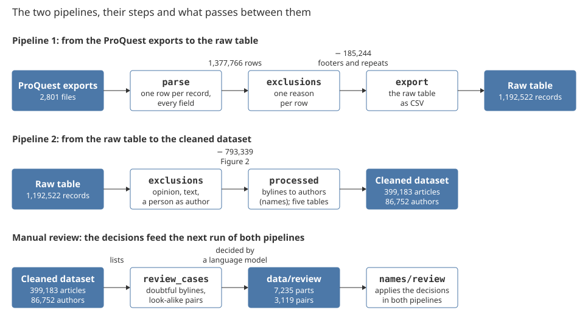
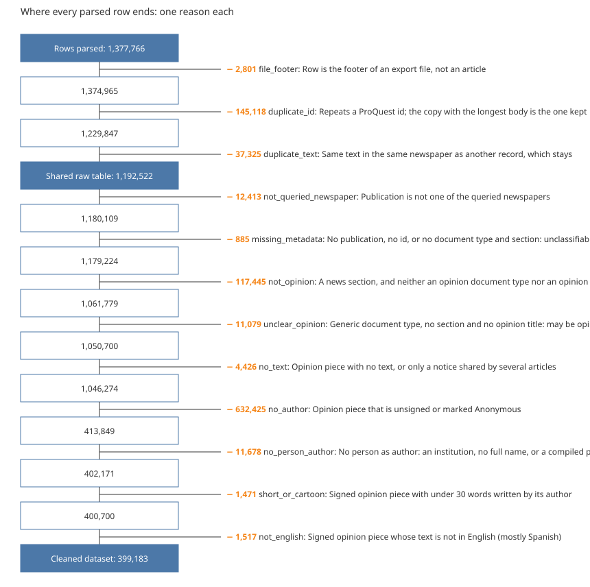
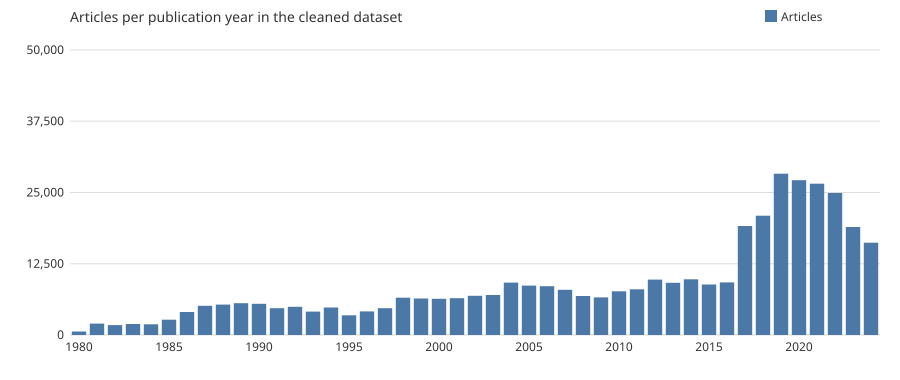
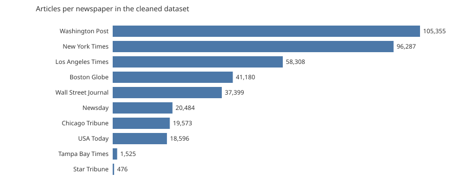

<!-- docs/datasheet.md is generated from docs/datasheet.template.md by `make overview`, which
fills the double-brace names with numbers from the data. Change the prose in the template,
never in the generated file. -->

# econ_corpus: from the ProQuest exports to a dataset of signed opinion articles

Overview, version 1.0 (2026-11-09). This document tells where the data come from, what the
package holds, what was done to the data and why, and what came out: a corpus built to study
how economists communicate with the public through newspaper opinion pieces. The code that
did it and two detailed data descriptors are in the repository (section 8).

| | |
|---|---|
| ProQuest export files | {{n_files}} |
| Rows parsed | {{n_parsed}} |
| Raw table | {{n_raw}} records |
| Cleaned dataset | {{n_articles}} articles, {{n_authors}} authors, {{n_links}} article–author links |
| Newspapers | {{n_newspapers}} (print and online editions) |
| Publication years | {{year_min}}–{{year_max}} |
| Manual review | {{n_review_parts}} byline parts and {{n_review_pairs}} pairs of names, decided by a language model |

## 1. Where the data come from

- **Source:** ProQuest US Newsstream, through the library proxy of the Universidad de los
  Andes. The text is ProQuest-licensed: internal use among the project's researchers only.
- **Newspapers:** the ten U.S. daily newspapers with the highest print circulation in 2023
  [1] that the subscription provides: New York Times, Washington Post, Wall Street Journal,
  Los Angeles Times, Boston Globe, Chicago Tribune, USA Today, Newsday, Tampa Bay Times and
  Star Tribune, print and online editions (New York Post is not provided).
- **Query:** the exact publication name AND `noft(opinion OR op-ed OR editorial)`, a search
  for those words in the full text; document type Commentary, Editorial or News; English.
  The query matches words, not genre, so news items that mention an editorial are returned
  too: that is why the pipeline below decides what is opinion.
- **Export:** 100 results per page, 500 records per `.txt` file, {{n_files}} files dated
  2024-11-22 to 2025-01-26, {{n_parsed}} records in all. The export inserts stray spaces
  inside metadata values (`En glish`, `Aug 29, 202 2`) and repeats records across files
  when download rounds overlap; the pipeline undoes both.

## 2. What is in the package

| File | What it is | Rows | Key columns |
|---|---|---|---|
| `datasheet.pdf` | This document | | |
| `1_raw_txt/` | The {{n_files}} ProQuest export files, untouched | | |
| `2_raw_csv/econ_corpus_raw.csv` | The raw table: one row per record, every metadata field as exported plus parsed copies (`doc_id`, `pub_year`, `pub_date`, `publication_key`), the text and its word count; footers and repeats removed, nothing else | {{n_raw}} | `doc_id` (the ProQuest id), `source_file` + `record_index` (where the record came from) |
| `3_clean/articles.csv` | The signed opinion articles: the rows of the raw table that passed every criterion of section 5.4, with `newspaper` and `edition` added | {{n_articles}} | `doc_id`, `newspaper`, `edition`, `pub_year`, `title`, `text` |
| `3_clean/authors.csv` | One row per author, as read from the bylines | {{n_authors}} | `author_id`, `name`, `articles`, `name_variants` |
| `3_clean/article_authors.csv` | Which author signed which article, in byline order | {{n_links}} | `doc_id`, `author_id`, `position`, `read` (as written, recovered or by the manual review) |

Cells hold article text with line breaks: read the CSVs with a data-analysis library, not a
spreadsheet (cells above 32,767 characters are cut by spreadsheet programs).

## 3. The pipeline

*Figure 1.* The two pipelines and the manual review. White boxes are steps (modules of the
package `econ_corpus`), filled boxes are data. Pipeline 1 turns the exports into the raw
table; pipeline 2 turns the raw table into the cleaned dataset; the manual review decides the
cases that no rule can, and its decisions are data that both pipelines read on their next run.

| Step | Module | What it does | Writes |
|---|---|---|---|
| 1 | `raw/parse` | Splits each export file into records and reads every metadata field and the text | `records.parquet` |
| 2 | `raw/exclusions` | Gives every row exactly one reason, from a table of reasons; three reasons leave the raw table, the rest only the cleaned dataset | `exclusions.parquet`, counts per reason, `econ_corpus_raw_reasons.csv` |
| 3 | `raw/export`, `raw/datasheet` | Writes the raw table as CSV and its datasheet | `econ_corpus_raw.csv`, `datasheet_raw.md` |
| 4 | `clean/processed` | Keeps the rows with reason `kept`, reads their bylines into authors (`names/`) and writes articles, authors and their links | `articles.csv`, `authors.csv`, `author_names.csv`, `article_authors.csv`, `author_candidates.csv` |
| 5 | `clean/review_cases` | Lists the cases that need a manual review, with their evidence | `data/review/cases/` |
| 6 | `clean/datasheet_clean` | Writes the datasheet of the cleaned dataset | `datasheet_clean.md` |
| 6b | `overview` | Writes this overview | `datasheet.md` |
| 7 | `check` | Rebuilds every datasheet, table, figure and case list and compares them with the ones on disk; stops the delivery if anything is stale | nothing |

## 4. Where every record ends

*Figure 2.* Every parsed row gets exactly one reason, so the counts add up:
{{n_parsed}} rows parsed, {{n_left_raw}} left out of the raw table, {{n_left_clean}} left
out of the cleaned dataset, {{n_articles}} articles kept. The reasons that leave the raw
table are facts of the export (a footer, a repeated id, a repeated text); the reasons that
leave the cleaned dataset are the inclusion criteria: an opinion piece, from one of the
queried newspapers, with at least 30 words of English text written by its author, signed by
at least one person.

## 5. The rules in force, step by step

Each table gives a rule, why it was taken and the evidence that supports it. The dates and the
evidence of every rule are in `docs/decisions.md`.

### 5.1 Reading the exports (`raw/parse`)

| Rule | Why | Evidence |
|---|---|---|
| A file is split at lines of exactly 60 underscores; the last piece, which starts with ProQuest's contact line, is the footer, kept as a row flagged `is_footer` | Records and footers must add up to the separators of each file | {{n_files}} footers, one per file |
| The metadata block is read backwards from its last line, block by block, while the block starts with a known label | The optional `Materia` line moves the start of the block, and body lines can look like labels (`Editorial: ...`) | More than a quarter of the records have no `Materia` line; a cross-check on one file in ten found no disagreement |
| Metadata values are stored as exported, with space-free, case-folded copies in `*_key` columns; the body is never altered | ProQuest inserts stray spaces inside values (`En glish`, `Aug 29, 202 2`); the body is the research object | Datasheet of the raw table, section 2.2 |
| Dates, years and ids are parsed with an explicit status (`ok`, `missing`, `unparseable`, `year_only`) | Nothing is dropped silently | Datasheet of the raw table, section 2.2 |
| The table is replaced only if every file passes its check (one footer, no text before the first record, no near-separator) | A failed parse must not overwrite a good table | All {{n_files}} files pass |

### 5.2 One reason per row (`raw/exclusions`, `raw/reasons`)

| Rule | Why | Evidence |
|---|---|---|
| The reasons live in one table, as data, applied in the order the datasets are built; every row gets exactly one | Counts per reason add up to the rows parsed | {{n_parsed}} rows, {{n_parsed}} reasons |
| `file_footer`: the last row of each file | Not a record | {{n_file_footer}} rows |
| `duplicate_id`: a ProQuest id seen more than once; the copy with the longest body stays, the earliest download on ties | Overlapping download rounds; some downloads came without body | {{n_duplicate_id}} rows; no id repeats inside one file; the 2014 peak is this artifact |
| `duplicate_text`: the same body in the same queried newspaper under another id, whatever the title and date; a body under 100 words is a repeat only under the same title and date | Print and online editions of one article, texts posted again; a short body can be a caption shared by different articles | {{n_duplicate_text}} rows |
| The copy of a repeated text that stays is a signed opinion piece with text, then the first published, then the earliest download | The raw table depends on facts of the export only, never on the name rules or the review | No row of the raw table depends on the review |

### 5.3 The raw table (`raw/export`)

| Rule | Why | Evidence |
|---|---|---|
| The raw table is the parsed table without footers, repeated ids and repeated texts of the queried newspapers; nothing else is removed or edited | Other researchers can draw their own samples; repeats do not belong in a shared file | {{n_raw}} records |
| The CSV carries a stamp of the records and the reasons it was made from; a CSV made from other inputs is refused | A change in any column must make the CSV stale | `export.is_current` |
| Text and CSV are never in the repository; the table is for internal use among the project's researchers | ProQuest licence | Datasheet of the raw table, section 6 |

### 5.4 The inclusion criteria (`raw/exclusions`, cleaned stage)

The reasons below apply to the rows of the raw table, in the order the datasets are built; a row with none is `kept`.

| Rule | Why | Evidence |
|---|---|---|
| `not_queried_newspaper`: a publication outside the ten queried newspapers | Only the queried newspapers are in the design | {{n_not_queried_newspaper}} rows (datasheet of the raw table, section 4.9) |
| `missing_metadata`: no publication, no id, or no document type and no section | The newspaper cannot be checked, there is no key, and calling it news would be a claim without evidence | {{n_missing_metadata}} rows |
| Opinion is marked by the document type (`opinion`, `editorial`, `commentary`, `op-ed`, `letter`, `column`), by an opinion section, by a page heading or tag in the title, or by the rubric `THE EDITORIAL PAGE` at the start of the text (USA Today, 1991–1997) | The document type alone is not reliable: about a third of the records of the raw table carry a non-opinion type in an opinion section (datasheet of the raw table, section 5.3); USA Today's opinion pages are filed by ProQuest as news | 2,325 texts start with the rubric; 293 signed pieces enter through it |
| `not_opinion`: a news section and no opinion mark; no other rubric in the text marks opinion | Opinion is taken from labels, titles and that one rubric | {{n_not_opinion}} rows; the sports debate page of USA Today (64 signed pieces) stays out |
| `unclear_opinion`: a generic document type, no section and no opinion title | The section that would settle it is missing | {{n_unclear_opinion}} rows; in an audit of 100, four signed op-eds |
| `no_text`: no body, or a body under 100 words carried by five or more different articles | Such a body is a notice or a credit ("text not available", a caption), not text | {{n_no_text}} rows |
| `no_author`: no byline, or ProQuest's `Anonymous` | An unsigned piece cannot be linked to a person | {{n_no_author}} rows, mostly editorials |
| `no_person_author`: the byline names only an institution or no full name; or the piece is a page compiled from the words of others, told by its byline (`Compiled by`), its heading (`Punchlines`, `Best of Late Night`, `Editorials elsewhere`, `What others are saying`, `In quotes`, `A sampling of opinions`), the frame of a weekly poll in its text, or, for USA Today, a piece under 300 words whose title names a late-night comedian or show | A page put together from the words of others is not the opinion of whoever signs it | {{n_no_person_author}} rows; 173 late-night round-ups, listed and checked one by one before the rule was applied |
| `short_or_cartoon`: fewer than 30 words written by the author, once the lines added around the text are removed (image credits and descriptions, notices, invitations to subscribe, lists of links, notes on the cartoonist; listed in `raw/prose.py`); texts of 150 words or more are not read | A drawing alone is not text, while a short letter and the paragraph a cartoonist writes under a drawing are; the 150-word bound protects long columns that open with a list | {{n_short_or_cartoon}} rows; without the bound, 30 long columns lost their text |
| `not_english`: fewer than 5% of the words in the first 2,000 characters are among 39 common English words | ProQuest labels every article English, but some online editions carry translations; in English prose those words are a fifth to a third | {{n_not_english}} rows, mostly Spanish |
| `kept`: everything else | The inclusion criteria | {{n_articles}} articles |

### 5.5 From bylines to authors (`names/`)

| Rule | Why | Evidence |
|---|---|---|
| `;` separates authors; a part is a person if it reads as `Given Family` (two to five capitalised name words, no institution word) or `Family, Given[, Suffix]`; titles, offices and degrees are dropped; one word is never a name | Explicit, tested rules instead of a name-recognition model that lost authors silently and let institutions through | {{n_links_as_written}} of {{n_links}} links ({{links_as_written_pct}}) read as written |
| A full name at the start of a longer part, a list of names with or without affiliations, and co-authors scrambled by the export are recovered | A name followed by a town or a role must not be lost | {{n_links_recovered}} links recovered |
| Who compiled a piece, who did not write it and the production credits of audio pieces are not authors (a person marked as a credit stays an author when first in the byline) | Compilers and production staff are not authors | {{n_parts_credit}} credits marked in the review |
| The name key ignores case, accents, punctuation and spaces; the same key is one author in any newspaper and year, so homonyms stay one author | Nothing in the export tells two people of one name apart | About 1% of the authors of a random sample; four pairs joined by a stray space |
| Two variants of a name (same first and family name, middle names and suffixes that do not contradict) are one author when linked through shared newspapers; one contradiction stops every merge in the group | Typos and different people cannot be told apart by rule alone | {{n_names_rule}} variants merged by the rule, {{n_names_review}} by the review |
| Look-alike pairs (one letter apart, nicknames, swapped names, conflicting middle names, no shared newspaper) are listed, never merged by rule | Left for the review | {{n_candidates}} pairs listed |

### 5.6 The manual review (`names/review`, `clean/review_cases`)

| Rule | Why | Evidence |
|---|---|---|
| No person reviewed the cases: a language model decided each one, shown the newspapers, the years and two headlines, without web search; a merge needs evidence, `unsure` otherwise | Doubtful cases are decided one by one, and the reviewer is declared | {{n_review_parts}} parts, {{n_review_pairs}} pairs |
| A byline part is `KEEP`, `UNSURE`, `NOBODY`, `CREDIT` or a corrected name; a pair is `same`, `different` or `unsure`; of two verdicts the more cautious stays | Decisions are data read by the pipeline, never edits to the rules | {{n_parts_corrected}} corrected, {{n_parts_nobody}} not a person, {{n_parts_keep}} kept, {{n_parts_unsure}} unsure; {{n_pairs_same}} same, {{n_pairs_different}} different, {{n_pairs_unsure}} unsure |
| Reviewed: look-alikes where both authors have two or more articles or one has twenty; variants of one author five or more years apart; names read as nobody | The riskiest merges and splits | {{n_candidates_not_reviewed}} look-alike pairs below the threshold were not reviewed |
| After a round, step 2 and pipeline 2 run again, until no case is listed | Every case is decided | Every case list is empty |

### 5.7 The tables and the guards (`clean/processed`, `clean/manifest`, `check`)

| Rule | Why | Evidence |
|---|---|---|
| Articles, authors, names and links are separate tables; each link records its position in the byline and how it was read | An article can have several authors and an author many articles | {{n_links}} links, {{one_author_pct}} of articles with one author |
| Every article has its own ProQuest id and at least one author, or the build stops | The tables must be consistent by construction | — |
| Records, reasons, review files, code and tables carry fingerprints; a step refuses inputs that do not belong together | A new parse, a change of rules or a review round must make the outputs stale | `manifest.json`, the parser stamp, the stamp of the raw CSV |
| `make check` rebuilds every datasheet, table, figure and case list and compares them byte for byte; the delivery runs only if it passes | One delivery, one state of the pipeline | — |

## 6. The cleaned dataset in numbers

*Figure 3.* Articles per publication year in the cleaned dataset.

*Figure 4.* Articles per newspaper in the cleaned dataset.

*Table 1.* Authors per article.

{{authors_per_article}}

*Table 2.* Articles per author.

{{articles_per_author}}

{{n_authors_one_article}} authors ({{authors_one_article_pct}}) have one article: letters to the
editor count as opinion, so many of them are readers.

## 7. Known limits

| Limit | Size | Where |
|---|---|---|
| Subtler duplicates are not detected: edited versions of one article, the same text in two newspapers | About 1,600 short bodies repeated under another title or date | Raw table, section 6 |
| Unsigned opinion is absent from the cleaned dataset | {{n_no_author}} pieces, in the raw table | Cleaned dataset, section 6 |
| Opinion is taken from ProQuest's labels: some reviews and analyses are in, opinion columns filed as news are out | 64 signed pieces of the sports debate page out; four signed op-eds in 100 undecided records | Cleaned dataset, section 6 |
| Compiled pages under headings not listed may stay | — | Cleaned dataset, section 6 |
| Authors may still be split | {{n_candidates_not_reviewed}} look-alike pairs not reviewed, {{n_candidates_unsure}} reviewed and left unsure | Cleaned dataset, section 6 |
| Authors may be wrongly merged; people with the same name are one author | Seven to nine of 100 authors with several variants held more than one person; about 1% of authors share a name | Cleaned dataset, section 6 |
| Residual reading errors | Four audits of 300 authors: 1.7%, 0.7%, 0.3% and 0% wrong | Cleaned dataset, section 6 |
| The cartoon rule lists the added lines it knows; a letter under 30 words is left out | — | Cleaned dataset, section 6 |
| Credits of the opinion videos of the New York Times are read as authors | — | Cleaned dataset, section 6 |
| The reviewer is a language model and can be wrong | Audits of its decisions in `datasheet_clean.md`, section 2.4 | Cleaned dataset, section 2.4 |

## 8. Code and detailed documents

Everything above was done by the code of the private repository `econ_corpus`
(https://github.com/JuanReyes01/econ_corpus; access on request). It holds code and
documentation only, never the data. There:

- `README.md`: the commands that regenerate everything from the exports, from `make parse` on.
- `docs/datasheet_raw.md`: the raw table in detail, every change applied to the export, its contents.
- `docs/datasheet_clean.md`: the cleaned dataset in detail, how the bylines were read, the manual review and its audits.
- `docs/decisions.md`: every rule, its reason and its evidence, dated.
- `data/review/` (kept with the data, not in the repository): the decisions of the manual review, each with its reason.

[1] Statista, "Largest daily newspapers in the United States in the six months to September
2023, by average print circulation," Feb. 19, 2024.
https://www.statista.com/statistics/272790/circulation-of-the-biggest-daily-newspapers-in-the-us/
