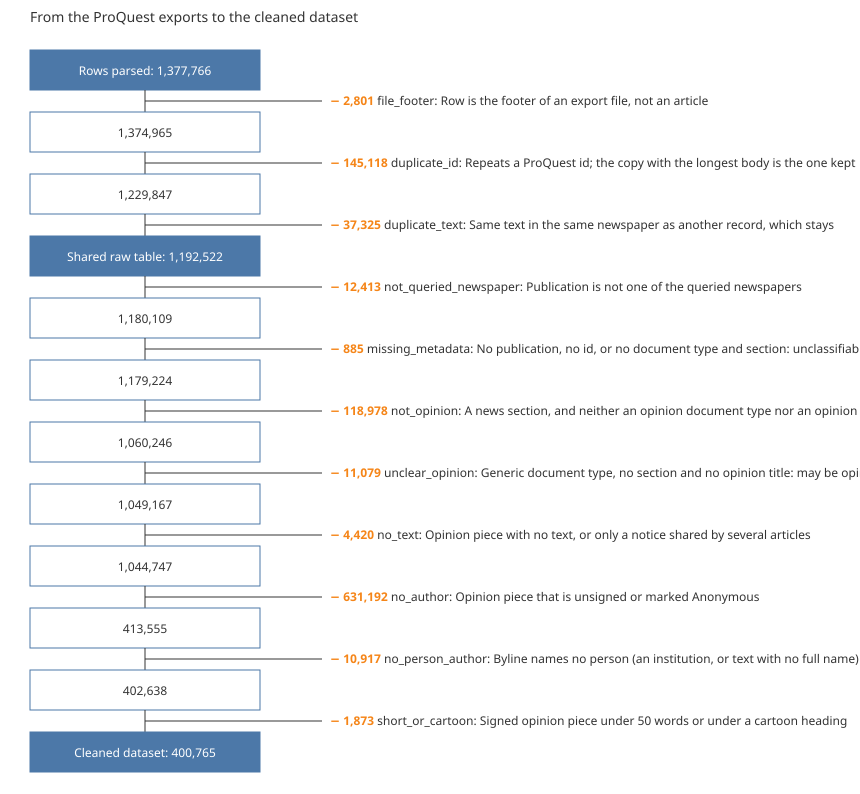

<!-- Prose template. `econ_corpus.datasheet_clean` fills the double-brace names with numbers
from the data and writes docs/datasheet_clean.md. Edit the prose here, never the generated file. -->

# A cleaned dataset of signed opinion articles in U.S. newspapers, 1980–2024

Data descriptor, version 1.0 (2026-11-08). Derived from the raw table described in
`docs/datasheet_raw.md`.

## Abstract

The dataset holds 404,638 opinion articles signed by at least one person, published
1980–2024 in ten U.S. newspapers with the highest circulation, and the
85,927 authors who signed them. Articles and authors are separate tables joined by a
link table, since an article can have several authors and an author many articles. The
dataset is derived from 1,377,766 rows parsed from ProQuest US Newsstream exports by a
sequence of exclusions, each row leaving for exactly one reason. Authors were read from the
bylines by explicit rules; name variants of one author were merged by a rule, and the doubtful
cases were decided in a manual review carried out by a large language model, which is
documented here.

## 1. Background and summary

The dataset supports the study of how economists communicate with the public through
newspaper opinion pieces. It keeps only what that study needs: opinion pieces, from the
queried newspapers, with text, signed by a person.

| | |
|---|---|
| Articles | 404,638 |
| Authors | 85,927 |
| Article–author links | 453,697 |
| Newspapers | 10 |
| Publication years | 1980–2024 |
| Articles with one author | 92.9% |
| Authors with one article | 50,806 (59.1%) |

## 2. Methods

### 2.1 Selection of articles

Every parsed row gets exactly one reason, so the counts add up. The first three exclusions
give the shared raw table; the others leave only the cleaned dataset (Figure 1).

*Figure 1.* Exclusions from the rows parsed to the cleaned dataset.

| Step | Left out | Records | Remaining |
|---|---|---|---|
| Rows parsed |  |  | 1,377,766 |
| file_footer | Row is the footer of an export file, not an article | 2,801 | 1,374,965 |
| duplicate_id | Repeats a ProQuest id; the copy with the longest body is the one kept | 145,118 | 1,229,847 |
| duplicate_text | Same body, title, date and newspaper as an earlier record | 2,908 | 1,226,939 |
| not_queried_newspaper | Publication is not one of the queried newspapers | 12,408 | 1,214,531 |
| missing_metadata | No document type, no section and no opinion title: cannot be classified | 885 | 1,213,646 |
| not_opinion | A news section, and neither an opinion document type nor an opinion title | 125,285 | 1,088,361 |
| unclear_opinion | Generic document type, no section and no opinion title: may be opinion | 11,153 | 1,077,208 |
| no_text | Opinion piece with no body text | 1,487 | 1,075,721 |
| no_author | Opinion piece that is unsigned or marked Anonymous | 660,049 | 415,672 |
| no_person_author | Byline names no person (an institution, or text with no full name) | 11,034 | 404,638 |

- **Opinion:** a record is opinion if its document type, its section or its title marks it
  as commentary, editorial, op-ed or letters. Records with no such mark are left out, either
  as news (`not_opinion`) or, when they have no section, as undecided (`unclear_opinion`).
- **Newspapers:** the ten queried newspapers, print and online editions.
- **Text and author:** an article needs body text and a byline that names at least one person.
  ProQuest's "Anonymous" and missing bylines are unsigned (`no_author`); a byline that names
  only an institution is `no_person_author`.

### 2.2 Reading the bylines

- `;` separates authors. A suffix standing alone joins the name before it, and a given name
  cut off from its family name is rejoined (`Lewis; , Flora`).
- A part is a person if it reads as `Family, Given[, Suffix]` or `Given Family`: two to five
  capitalised name words, no institution word, no digits. Titles (Dr., Sen.) are dropped. One
  word is never taken as a name.
- If a part does not read as a name, a full name at its start is recovered
  (`Jane Doe. Springfield`, `Jane Doe is a columnist`).
- Of 453,697 links, 434,501 (95.8%) were read as
  written, 15,822 were recovered and 3,374 come from the manual
  review (section 2.4). Each link records how it was read.

### 2.3 Deciding that two names are one author

- **Name key:** case, accents, periods, apostrophes, hyphens and spaces are ignored, so
  spelling variants and ProQuest's stray spaces give one key. Middle names and suffixes are
  kept.
- **Rule:** names with the same first and family name are one author when their middle names
  and suffixes do not contradict each other (one is missing, or one is the initial of the
  other) and they share at least one newspaper. One contradiction among such names stops
  every merge among them.
- **Result:** 89,404 name variants for 85,927 authors; 3,159 variants
  were merged by the rule and 318 by the manual review.
- **Not merged:** 4,398 pairs of look-alike authors are listed, not merged
  (section 3.5).

### 2.4 Manual review by a large language model

No person reviewed the cases. Each case was read and decided one by one by a large language
model (Claude, Anthropic), without web search, under written instructions: merge only with
supporting evidence, and answer "unsure" when in doubt. The evidence shown for an author was
its newspapers, its years and two headlines.

| Reviewed | Cases | Outcome |
|---|---|---|
| Byline parts (ambiguous, holding a place or publication word, or read as nobody) | 3,591 | 2,278 corrected, 1,017 not a person, 248 kept as read, 48 unsure |
| Pairs of look-alike authors with two or more articles each | 1,081 | 316 same person, 486 different, 279 unsure |

- **Models:** most cases were decided by Claude Sonnet run as subagents; the rest, and the
  checks, by Claude Fable 5.1. The reviewer of every decision is recorded in the review files.
- **Checks:** random samples of the decisions were read again by a second model (85, then 90
  decisions) and none was changed; the set was checked for contradictions.
- **How decisions are applied:** they are data read by the pipeline, never edits to the
  rules. A corrected byline and a merge by review are marked `manual_review`; a pair judged
  different is never merged by the rule; a pair judged unsure stays apart and flagged.
- **Limit:** a language model can be wrong, above all for authors it knows nothing about.
  The decisions and their reasons are delivered with the dataset so they can be audited.

## 3. Data records

Five CSV files (UTF-8, comma-separated). The article text is ProQuest-licensed: the dataset
is for internal use among the project's researchers.

### 3.1 `articles.csv`

One row per article, keyed by `doc_id` (the ProQuest id). It has every column of the raw table
(see its datasheet) except `is_footer`, plus:

| Column | Type | Content |
|---|---|---|
| `newspaper` | string | One of the ten newspapers, the same for its print and online editions |
| `edition` | string | `print`, `online` or `pre-1997` (ProQuest's label for older records) |

`author` keeps the byline as exported; the authors read from it are in the tables below.

### 3.2 `authors.csv`

| Column | Type | Content |
|---|---|---|
| `author_id` | integer | Key, numbered in the order of the name keys |
| `name` | string | Commonest spelling of the author's main name variant, given name first |
| `articles` | integer | Articles signed |
| `name_variants` | integer | Name variants merged into this author |

### 3.3 `author_names.csv`

| Column | Type | Content |
|---|---|---|
| `author_id` | integer | Author the variant belongs to |
| `name` | string | The variant, given name first |
| `name_key` | string | Its key (section 2.3) |
| `articles` | integer | Articles in which the variant appears |
| `rule` | string | `main` (the variant that names the author), `shared_newspaper` (merged by the rule) or `manual_review` |

### 3.4 `article_authors.csv`

The many-to-many link.

| Column | Type | Content |
|---|---|---|
| `doc_id` | integer | Article |
| `author_id` | integer | Author |
| `position` | integer | Order in the byline, from 1 |
| `read` | string | `as_written`, `recovered` or `manual_review` (section 2.2) |

### 3.5 `author_candidates.csv`

Pairs of authors that look alike and are not merged.

| Column | Type | Content |
|---|---|---|
| `author_id_a`, `name_a`, `articles_a` | | First author of the pair |
| `author_id_b`, `name_b`, `articles_b` | | Second author |
| `kind` | string | `no_shared_newspaper` (compatible names never in the same newspaper), `conflicting_names` (middle names or suffixes contradict within the group), `one_letter_apart` (keys one letter apart in the same newspaper) or `apart_by_review` |
| `review` | string | `different`, `unsure` or `not_reviewed` |

## 4. Contents

### 4.1 Newspapers

| Newspaper | Articles | Print | Online | Pre-1997 | Share |
|---|---|---|---|---|---|
| Washington Post | 110,560 | 50,132 | 47,964 | 12,464 | 27.3% |
| New York Times | 94,215 | 64,378 | 29,837 | 0 | 23.3% |
| Los Angeles Times | 58,743 | 33,160 | 10,115 | 15,468 | 14.5% |
| Boston Globe | 41,333 | 23,373 | 5,810 | 12,150 | 10.2% |
| Wall Street Journal | 38,218 | 1,964 | 36,254 | 0 | 9.4% |
| Chicago Tribune | 20,466 | 4,332 | 12,658 | 3,476 | 5.1% |
| Newsday | 20,036 | 20,036 | 0 | 0 | 5.0% |
| USA Today | 19,181 | 2,893 | 16,288 | 0 | 4.7% |
| Tampa Bay Times | 1,526 | 98 | 1,428 | 0 | 0.4% |
| Star Tribune | 360 | 360 | 0 | 0 | 0.1% |
| Total | 404,638 | 200,726 | 160,354 | 43,558 | 100.0% |

### 4.2 Decades

| Decade | Articles | Share |
|---|---|---|
| 1980s | 29,028 | 7.2% |
| 1990s | 49,243 | 12.2% |
| 2000s | 74,730 | 18.5% |
| 2010s | 135,153 | 33.4% |
| 2020s | 116,469 | 28.8% |
| Unknown year | 15 | 0.0% |

### 4.3 Authors per article

| Authors | Articles | Share |
|---|---|---|
| 1 | 375,997 | 92.9% |
| 2 | 20,921 | 5.2% |
| 3 | 2,945 | 0.7% |
| 4 | 1,693 | 0.4% |
| 5 or more | 3,082 | 0.8% |

### 4.4 Articles per author

| Articles | Authors | Share |
|---|---|---|
| 1 | 50,806 | 59.1% |
| 2 to 9 | 30,422 | 35.4% |
| 10 to 99 | 4,289 | 5.0% |
| 100 or more | 410 | 0.5% |

### 4.5 Most frequent authors

| Author | Articles |
|---|---|
| Jennifer Rubin | 5,067 |
| George F Will | 3,880 |
| Paul Krugman | 3,541 |
| EJ Dionne Jr | 3,053 |
| Ellen Goodman | 2,747 |
| David Ignatius | 2,736 |
| Thomas L Friedman | 2,381 |
| Nicholas Kristof | 2,364 |
| Jeff Jacoby | 2,353 |
| Maureen Dowd | 2,315 |
| James Freeman | 2,303 |
| Richard Cohen | 2,273 |
| David S Broder | 2,228 |
| Paul Waldman | 2,153 |
| Joan Vennochi | 2,147 |

### 4.6 How the names were read

| Read | Count | Share |
|---|---|---|
| as_written | 434,501 | 95.8% |
| recovered | 15,822 | 3.5% |
| manual_review | 3,374 | 0.7% |

## 5. Technical validation

- **Keys:** every article has its own ProQuest id; every link points to an article and an
  author that exist; every article has at least one author. The build stops otherwise.
- **Reasons:** they are matched to the records by file and position in the file, and the
  counts per reason add up to the rows parsed.
- **Review:** a review file with a repeated case, an unknown verdict or an unreadable
  correction stops the build, and so does a pair judged different that ends up merged.
- **Look-alike authors left apart** (kind / review):

| Kind / review | Count | Share |
|---|---|---|
| conflicting_names / not_reviewed | 1,711 | 38.9% |
| no_shared_newspaper / not_reviewed | 1,218 | 27.7% |
| one_letter_apart / not_reviewed | 796 | 18.1% |
| conflicting_names / different | 230 | 5.2% |
| conflicting_names / unsure | 167 | 3.8% |
| one_letter_apart / different | 142 | 3.2% |
| no_shared_newspaper / unsure | 74 | 1.7% |
| no_shared_newspaper / different | 35 | 0.8% |
| one_letter_apart / unsure | 24 | 0.5% |
| apart_by_review / different | 1 | 0.0% |

## 6. Usage notes and limitations

- **Unsigned opinion is absent:** 660,049 opinion pieces have no author, mostly
  editorials. They are in the raw table.
- **Bylines that name nobody:** 11,034 articles, signed by an editorial
  board, a publication or a role.
- **Authors may still be split:** of the 4,398 look-alike pairs,
  3,725 were not reviewed, most because one of the two authors has a
  single article. 265 were reviewed and left unsure.
- **Authors may be wrongly merged:** the rule needs a shared newspaper and compatible names,
  which two people with a common name can meet.
- **Readers' letters:** letters to the editor count as opinion, so many authors with one
  article are readers.
- **One word is never a name:** pen names of one word and bylines cut to one word are lost.
- **Subtler duplicates** (reprints, edited versions under another title) are not detected.

## 7. Code availability

The pipeline is in the private repository `econ_corpus` [1]: `exclusions` and `reasons`
(selection), `authors` and `bylines` (reading names), `identity` (one author), `review` and
`review_cases` (manual review), `processed` (tables) and `datasheet_clean` (this document).
Every rule and its evidence are in `docs/decisions.md`. `make exclusions`, `make processed`
and `make datasheet-clean` regenerate the dataset and this document.

## 8. References

[1] J. C. Reyes, "econ_corpus: build and audit a corpus of U.S. newspaper opinion articles,"
GitHub repository, 2026. Accessed: Nov. 8, 2026. [Online]. Available:
https://github.com/JuanReyes01/econ_corpus
