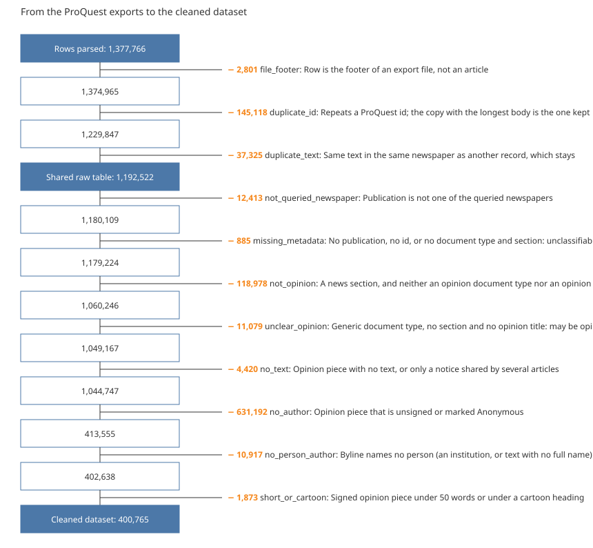

<!-- docs/datasheet_clean.md is generated from docs/datasheet_clean.template.md by
`make datasheet-clean`, which fills the double-brace names with numbers from the data. Change
the prose in the template, never in the generated file. -->

# A cleaned dataset of signed opinion articles in U.S. newspapers, {{year_min}}–{{year_max}}

Data descriptor, version 1.0 (2026-11-08). Derived from the raw table described in
`docs/datasheet_raw.md`.

## Abstract

The dataset holds {{n_articles}} opinion articles signed by at least one person, published
{{year_min}}–{{year_max}} in ten U.S. newspapers with the highest circulation, and the
{{n_authors}} authors who signed them. Articles and authors are separate tables joined by a
link table, since an article can have several authors and an author many articles. The
dataset is derived from {{n_parsed}} rows parsed from ProQuest US Newsstream exports by a
sequence of exclusions, each row leaving for exactly one reason. Authors were read from the
bylines by explicit rules; name variants of one author were merged by a rule, and the doubtful
cases were decided in a manual review carried out by a large language model, which is
documented here.

## 1. Background and summary

The dataset supports the study of how economists communicate with the public through
newspaper opinion pieces. It keeps only what that study needs: opinion pieces, from the
queried newspapers, with text, signed by a person.

| | |
|---|---|
| Articles | {{n_articles}} |
| Authors | {{n_authors}} |
| Article–author links | {{n_links}} |
| Newspapers | {{n_newspapers}} |
| Publication years | {{year_min}}–{{year_max}} |
| Articles with one author | {{one_author_pct}} |
| Authors with one article | {{n_authors_one_article}} ({{authors_one_article_pct}}) |

## 2. Methods

### 2.1 Selection of articles

Every parsed row gets exactly one reason, so the counts add up. The first three exclusions
give the shared raw table; the others leave only the cleaned dataset (Figure 1).

*Figure 1.* Exclusions from the rows parsed to the cleaned dataset.

{{flow}}

- **Opinion:** a record is opinion if its document type, its section or its title marks it
  as commentary, editorial, op-ed or letters. Records with no such mark are left out, either
  as news (`not_opinion`) or, when they have no section, as undecided (`unclear_opinion`).
- **Newspapers:** the ten queried newspapers, print and online editions.
- **Text and author:** an article needs body text and a byline that names at least one person.
  A body carried by twenty or more different articles is a placeholder ("text not available"),
  not text (`no_text`). ProQuest's "Anonymous" and missing bylines are unsigned (`no_author`);
  a byline that names only an institution is `no_person_author`.

### 2.2 Reading the bylines

- `;` separates authors. A suffix standing alone joins the name before it, and a given name
  cut off from its family name is rejoined (`Lewis; , Flora`).
- A part is a person if it reads as `Family, Given[, Suffix]` or `Given Family`: two to five
  capitalised name words, no institution word, no digits. Titles and offices before the name
  (Dr., Sen., State Rep) and degrees after it (MD, PhD) are dropped. One word is never taken as
  a name.
- If a part does not read as a name, a full name at its start is recovered
  (`Jane Doe. Springfield`, `Jane Doe is a columnist`), and co-authors that the export
  scrambled are put back (`Doe, Jane Roe and Ann` is Jane Roe and Ann Doe).
- Of {{n_links}} links, {{n_links_as_written}} ({{links_as_written_pct}}) were read as
  written, {{n_links_recovered}} were recovered and {{n_links_manual}} come from the manual
  review (section 2.4). Each link records how it was read.

### 2.3 Deciding that two names are one author

- **Name key:** case, accents, periods, apostrophes, hyphens and spaces are ignored, so
  spelling variants and ProQuest's stray spaces give one key. Middle names and suffixes are
  kept.
- **Rule:** names with the same first and family name are one author when their middle names
  and suffixes do not contradict each other (one is missing, or one is the initial of the
  other, compared name by name) and they share at least one newspaper. One contradiction among such names stops
  every merge among them.
- **Result:** {{n_names}} name variants for {{n_authors}} authors; {{n_names_rule}} variants
  were merged by the rule and {{n_names_review}} by the manual review.
- **Not merged:** {{n_candidates}} pairs of look-alike authors are listed, not merged
  (section 3.5).

### 2.4 Manual review by a large language model

No person reviewed the cases. Each case was read and decided one by one by a large language
model (Claude, Anthropic), without web search, under written instructions: merge only with
supporting evidence, and answer "unsure" when in doubt. The evidence shown for an author was
its newspapers, its years and two headlines.

| Reviewed | Cases | Outcome |
|---|---|---|
| Byline parts (ambiguous, holding a place or publication word, or read as nobody) | {{n_review_parts}} | {{n_parts_corrected}} corrected, {{n_parts_nobody}} not a person, {{n_parts_keep}} kept as read, {{n_parts_unsure}} unsure |
| Pairs of look-alike authors with two or more articles each | {{n_review_pairs}} | {{n_pairs_same}} same person, {{n_pairs_different}} different, {{n_pairs_unsure}} unsure |

- **Models:** most cases were decided by Claude Sonnet run as subagents; the rest, and the
  checks, by Claude Fable 5.1. The reviewer of every decision is recorded in the review files.
- **Checks:** random samples of the decisions of the first and third rounds (about 175) were
  read again by a second model, which rewrote two suffixes and changed no decision; an
  independent audit of the output then found credits of interviewers and illustrators taken as
  authors, which were corrected. The set was checked for contradictions. The rounds are
  described in the README of the review files.
- **How decisions are applied:** they are data read by the pipeline, never edits to the
  rules. A corrected byline and a merge by review are marked `manual_review`. A pair judged
  different is never merged by the rule. A pair judged unsure is left to the rule: it stays
  apart, with its verdict in the list of look-alike pairs, unless the rule later merges it.
- **Limit:** a language model can be wrong, above all for authors it knows nothing about.
  The decisions and their reasons are delivered with the dataset so they can be audited.

## 3. Data records

Five CSV files (UTF-8, comma-separated). The article text is ProQuest-licensed: the dataset
is for internal use among the project's researchers.

### 3.1 `articles.csv`

One row per article, keyed by `doc_id` (the ProQuest id). It has every column of the raw table
(see its datasheet) except `is_footer`, plus:

| Column | Type | Content |
|---|---|---|
| `newspaper` | string | One of the ten newspapers, the same for its print and online editions |
| `edition` | string | `print`, `online` or `pre-1997` (ProQuest's label for older records) |

`author` keeps the byline as exported; the authors read from it are in the tables below.

### 3.2 `authors.csv`

| Column | Type | Content |
|---|---|---|
| `author_id` | integer | Key, numbered in the order of the name keys |
| `name` | string | Commonest spelling of the author's main name variant, given name first |
| `articles` | integer | Articles signed |
| `name_variants` | integer | Name variants merged into this author |

### 3.3 `author_names.csv`

| Column | Type | Content |
|---|---|---|
| `author_id` | integer | Author the variant belongs to |
| `name` | string | The variant, given name first |
| `name_key` | string | Its key (section 2.3) |
| `articles` | integer | Articles in which the variant appears |
| `rule` | string | `main` (the variant that names the author), `shared_newspaper` (merged by the rule) or `manual_review` |

### 3.4 `article_authors.csv`

The many-to-many link.

| Column | Type | Content |
|---|---|---|
| `doc_id` | integer | Article |
| `author_id` | integer | Author |
| `position` | integer | Order in the byline, from 1 |
| `read` | string | `as_written`, `recovered` or `manual_review` (section 2.2) |

### 3.5 `author_candidates.csv`

Pairs of authors that look alike and are not merged.

| Column | Type | Content |
|---|---|---|
| `author_id_a`, `name_a`, `articles_a` | | First author of the pair |
| `author_id_b`, `name_b`, `articles_b` | | Second author |
| `kind` | string | `no_shared_newspaper` (compatible names never in the same newspaper), `conflicting_names` (middle names or suffixes contradict within the group), `one_letter_apart` (keys one letter apart in the same newspaper), `nickname` (first names that are short forms of each other, in the same newspaper), `swapped_names` (given and family name the other way round) or `apart_by_review` |
| `review` | string | `different`, `unsure` or `not_reviewed`. A verdict on a pair that no rule lists any more is kept in the review files only |

## 4. Contents

### 4.1 Newspapers

{{newspapers}}

### 4.2 Decades

{{decades}}

### 4.3 Authors per article

{{authors_per_article}}

### 4.4 Articles per author

{{articles_per_author}}

### 4.5 Most frequent authors

{{top_authors}}

### 4.6 How the names were read

{{read}}

## 5. Technical validation

- **Keys:** every article has its own ProQuest id; every link points to an article and an
  author that exist; every article has at least one author. The build stops otherwise.
- **Reasons:** they are matched to the records by file and position in the file, and the
  counts per reason add up to the rows parsed.
- **Review:** a review file with a repeated case, an unknown verdict or an unreadable
  correction stops the build, and so does a pair judged different that ends up merged. The
  reasons carry a fingerprint of the corrections they were computed with, and the tables and
  this document refuse reasons computed with other corrections.
- **Look-alike authors left apart** (kind / review):

{{candidate_kinds}}

## 6. Usage notes and limitations

- **Unsigned opinion is absent:** {{n_no_author}} opinion pieces have no author, mostly
  editorials. They are in the raw table.
- **Bylines that name nobody:** {{n_no_person_author}} articles, signed by an editorial
  board, a publication or a role.
- **Authors may still be split:** of the {{n_candidates}} look-alike pairs,
  {{n_candidates_not_reviewed}} were not reviewed, most because one of the two authors has a
  single article. {{n_candidates_unsure}} were reviewed and left unsure.
- **Authors may be wrongly merged:** the rule needs a shared newspaper and compatible names,
  which two people with a common name can meet.
- **Readers' letters:** letters to the editor count as opinion, so many authors with one
  article are readers.
- **One word is never a name:** pen names of one word and bylines cut to one word are lost.
- **Subtler duplicates** (reprints, edited versions under another title) are not detected.

## 7. Code availability

The pipeline is in the private repository `econ_corpus` [1]: `exclusions` and `reasons`
(selection), `authors` and `bylines` (reading names), `identity` (one author), `review` and
`review_cases` (manual review), `processed` (tables) and `datasheet_clean` (this document).
Every rule and its evidence are in `docs/decisions.md`. `README.md` lists the commands, from
`make parse` on, that regenerate the dataset and this document.

## 8. References

[1] J. C. Reyes, "econ_corpus: build and audit a corpus of U.S. newspaper opinion articles,"
GitHub repository, 2026. Accessed: Nov. 8, 2026. [Online]. Available:
https://github.com/JuanReyes01/econ_corpus
