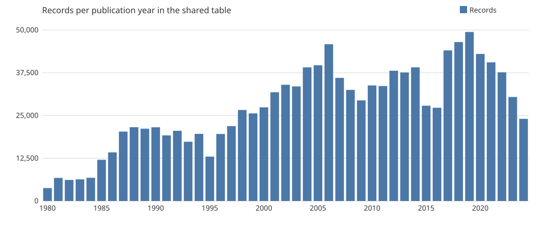

<!-- Prose template. `econ_corpus.datasheet` fills the double-brace names with numbers from the
data and writes docs/datasheet_raw.md. Edit the prose here, never the generated file. -->

# A raw table of U.S. newspaper opinion articles from ProQuest US Newsstream, 1980–2024

Data descriptor, version 1.0 (2026-11-02). Companion to the cleaned dataset derived from this table.

## Abstract

The table holds 1,374,965 records exported from ProQuest US Newsstream for ten U.S.
newspapers with the highest circulation, published 1980–2024. Each record keeps
its metadata as exported, parsed dates, years and identifiers with explicit quality flags, its
file of origin, and a hash and word count of the article text. Nothing was removed or corrected,
so the table documents the source as delivered, including duplicates, news items and publications
outside the query. A companion table assigns every record one exclusion reason. This descriptor
reports how the data were collected and parsed, what they contain, and where they depart from
the intended design.

## 1. Background and summary

The table is the first stage of a corpus built to study how economists communicate with the
public through newspaper opinion pieces. It is a faithful reorganisation of the ProQuest exports,
kept raw so that other researchers can derive their own samples from it.

| | |
|---|---|
| Records | 1,374,965 (plus 2,801 file-footer rows, one per export file) |
| Export files | 2,801 |
| Publication years | 1980–2024 |
| Newspapers queried | 10 |
| Distinct ProQuest ids | 1,228,965 |
| Records with a named author | 667,831 (48.6%) |

## 2. Methods

### 2.1 Collection

- **Source:** ProQuest US Newsstream, through the Universidad de los Andes library proxy.
- **Period:** exports dated 2024-11-22 to 2025-01-26.
- **Newspapers:** 10, selected for having the highest circulation in the
  U.S. Online editions are included on purpose, since much current opinion is published online.
  New York Post is not provided by the subscription.
- **Query:** exact publication name AND `noft(opinion OR op-ed OR editorial)`, a full-text
  search for those words.
- **Filters:** document type Commentary, Editorial or News; English; date range resumed from the
  last download.
- **How:** 100 results per page, select all, export every 5 pages (500 records) to a `.txt`
  file. CAPTCHAs solved by hand.

### 2.2 Parsing

- Each export file is split at lines of exactly 60 underscores. The last separator is followed
  by a footer, kept as a row with `is_footer` set.
- A record is a header, the body (after `Texto completo:`) and a block of `Label: value`
  metadata lines. The block is read backwards from its last line, one blank-separated block at a
  time, for as long as the block starts with a known label. This is needed because the optional
  `Materia` line makes the block start vary, and body lines can look like labels.
- Stray spaces that ProQuest inserts inside metadata values (`En glish`, `Aug 29, 202 2`) are
  tolerated when parsing. Values are stored as exported; space-free, case-folded copies are
  stored in the `*_key` columns. The body is never altered.
- Dates, years and identifiers are parsed with an explicit status (`ok`, `missing`,
  `unparseable`, and `year_only` for dates). No value is silently dropped.
- Provenance is kept in `source_file` and `record_index`. The article text is replaced by its
  SHA-256 hash, word count and character count.

### 2.3 Quality control

- Per file, the records found are compared with the separator lines counted independently: all
  2,801 files contain one footer and as many records as separators.
- The detection of the `Materia` line was cross-checked against a plain text search on one in
  ten files, with no disagreement (details in `docs/decisions.md`). The cross-check found and
  fixed a parsing gap that had hidden `Materia` in 3.9% of records.
- Tests use synthetic records only, and every rule is logged with its evidence in
  `docs/decisions.md`.

## 3. Data records

### 3.1 Raw table

One row per record, in `data/interim/records.parquet`. The article text is ProQuest-licensed and
is not included.

| Column | Type | Content |
|---|---|---|
| `source_file` | string | Export file the record comes from |
| `record_index` | integer | Position in the file, from 0; the footer is last |
| `is_footer` | boolean | Row is the file footer, not an article |
| `title`, `author`, `publication`, `section` | string | Metadata as exported; multi-line values joined |
| `language`, `source_type`, `doc_type` | string | Metadata as exported |
| `year_raw`, `date_raw`, `id_raw` | string | Publication year, publication date and ProQuest id as exported |
| `pub_year`, `date_year`, `doc_id` | integer | Parsed year, year of the parsed date, and ProQuest id |
| `pub_date` | date | Parsed publication date; empty if only a year is given |
| `year_status`, `date_status`, `id_status` | string | `ok`, `missing`, `unparseable`; dates also `year_only` |
| `publication_key`, `language_key`, `source_type_key`, `doc_type_key` | string | Space-free, case-folded copies for comparing categories |
| `has_materia` | boolean | Record has a `Materia` (subject) line |
| `n_meta_fields` | integer | Metadata lines recognised in the record |
| `has_body` | boolean | Record has body text |
| `body_words`, `body_chars` | integer | Word and character counts of the body |
| `body_sha256` | string | SHA-256 hash of the body text |

### 3.2 Companion files

- `data/interim/exclusions.parquet`: `source_file`, `record_index` and one exclusion `reason`
  per row (section 6).
- `reports/tables/raw_by_year.csv` and `reports/tables/raw_by_download_date.csv`: yearly counts,
  and counts and publication-year range per download date.
- `reports/figures/records_by_year.svg`: Figure 1.

## 4. Contents

### 4.1 Newspapers

*With author*: share of records with a named author.

| Newspaper | Records | Print | Online | Pre-1997 | Blog/podcast/website | With author |
|---|---|---|---|---|---|---|
| New York Times | 436,870 | 164,497 | 272,373 | 0 | 272,373 | 32.7% |
| Washington Post | 309,813 | 149,105 | 106,335 | 54,373 | 106,335 | 48.7% |
| Wall Street Journal | 146,424 | 50,628 | 95,796 | 0 | 0 | 70.8% |
| Los Angeles Times | 156,255 | 89,699 | 15,892 | 50,664 | 15,892 | 55.4% |
| Boston Globe | 111,494 | 62,347 | 9,150 | 39,997 | 0 | 56.1% |
| Chicago Tribune | 78,621 | 29,326 | 24,118 | 25,177 | 24,118 | 49.5% |
| USA Today | 39,373 | 14,530 | 20,379 | 4,464 | 0 | 73.5% |
| Newsday | 57,384 | 57,384 | 0 | 0 | 0 | 62.8% |
| Tampa Bay Times | 15,992 | 12,904 | 3,088 | 0 | 3,088 | 22.4% |
| Star Tribune | 7,722 | 7,722 | 0 | 0 | 0 | 76.6% |
| Other | 14,132 | 13,558 | 560 | 14 | 875 | 55.6% |
| No metadata | 885 | 0 | 0 | 0 | 0 | 0.0% |
| Total | 1,374,965 | 651,700 | 547,691 | 174,689 | 422,681 | 48.6% |

### 4.2 Online editions and the blog label

| Newspaper | Online records | First year | Labelled blog/podcast/website | Years with both labels |
|---|---|---|---|---|
| New York Times | 272,373 | 1996 | 100.0% | 0 |
| Washington Post | 106,335 | 2011 | 100.0% | 0 |
| Wall Street Journal | 95,796 | 2010 | 0.0% | 0 |
| Los Angeles Times | 15,892 | 2017 | 100.0% | 0 |
| Boston Globe | 9,150 | 2006 | 0.0% | 0 |
| Chicago Tribune | 24,118 | 2017 | 100.0% | 0 |
| USA Today | 20,379 | 2014 | 0.0% | 0 |
| Tampa Bay Times | 3,088 | 2017 | 100.0% | 0 |

### 4.3 Blog-labelled records by document type

| Document type | Blog-labelled records | Share of blog-labelled |
|---|---|---|
| News | 200,097 | 47.3% |
| Opinions | 167,387 | 39.6% |
| Editorial | 58,456 | 13.8% |
| Commentary | 56,468 | 13.4% |
| Letter To The Editor | 253 | 0.1% |
| New s | 122 | 0.0% |

### 4.4 Years

*Figure 1.* Records and distinct ProQuest ids per publication year.

| Decade | Records | Unique ids | With author |
|---|---|---|---|
| 1980s | 127,871 | 119,082 | 46.9% |
| 1990s | 217,596 | 205,523 | 40.8% |
| 2000s | 368,954 | 350,967 | 36.3% |
| 2010s | 475,705 | 377,601 | 53.4% |
| 2020s | 183,932 | 175,768 | 71.2% |
| Unknown year | 907 | 24 | 1.9% |

### 4.5 Document types and authorship

A record with two labels counts once under each. Editorials are mostly unsigned; commentary and
op-eds mostly signed.

| Document type | Records | With author |
|---|---|---|
| News | 376,127 | 46.0% |
| Editorial | 316,472 | 24.2% |
| NEWSPAPER | 283,251 | 44.6% |
| Opinions | 266,798 | 54.4% |
| Commentary | 234,971 | 88.7% |
| Op-Ed | 9,762 | 94.9% |
| OP-ED | 6,423 | 94.5% |
| EDITORIAL | 5,984 | 1.6% |
| Opinion | 5,356 | 87.2% |
| Letter To The Editor | 2,856 | 0.1% |
| editorial | 2,621 | 1.8% |
| Opinion Piece | 2,392 | 98.3% |

### 4.6 Sections

Top labels, grouped ignoring case. Each newspaper names its sections differently.

| Section | Records | Share |
|---|---|---|
| opinion | 441,618 | 32.1% |
| a | 120,076 | 8.7% |
| editorial | 118,919 | 8.6% |
| editorial-opinion | 85,535 | 6.2% |
| opinions | 55,016 | 4.0% |
| op/ed | 39,623 | 2.9% |
| news | 36,492 | 2.7% |
| editorial - opinion | 35,412 | 2.6% |
| editorial page | 24,239 | 1.8% |
| op-ed | 18,742 | 1.4% |
| california metro; part b; editorial pages desk | 17,261 | 1.3% |
| main news; part a; editorial desk | 14,749 | 1.1% |

### 4.7 Language

| Language | Records | Share |
|---|---|---|
| English only | 1,372,781 | 99.8% |
| Includes Spanish | 1,299 | 0.1% |
| Missing | 885 | 0.1% |

### 4.8 Missing values

| Field | Missing | Share |
|---|---|---|
| Title | 889 | 0.1% |
| Author | 707,134 | 51.4% |
| Section | 54,446 | 4.0% |
| Full publication date | 26,370 | 1.9% |
| Document id | 882 | 0.1% |
| Body text | 2,500 | 0.2% |

### 4.9 Publications outside the query

Most common first. These are removed in the cleaned dataset (reason `not_queried_newspaper`).

| Publication | Records |
|---|---|
| Washington Examiner; Washington, D.C. | 1,706 |
| La Opinión; Los Angeles, Calif. | 1,283 |
| Philadelphia Daily News; Philadelphia, Pa. | 414 |
| The Press Democrat; Santa Rosa, Calif. | 413 |
| South Florida Sun - Sentinel; Fort Lauderdale, Fla. | 330 |
| Pittsburgh Post - Gazette; Pittsburgh, Pa. | 259 |
| Politico, U.S. edition; Arlington | 240 |
| Orlando Sentinel (Online); Orlando | 200 |
| Public Opinion; Chambersburg, Pa. | 196 |
| Daily News; Los Angeles, Calif. | 191 |
| Reno Gazette - Journal; Reno, Nev. | 175 |
| York Daily Record; York, Pa. | 166 |

## 5. Technical validation

### 5.1 Do the filters hold?

| Filter | Result | Section |
|---|---|---|
| Newspapers | 295 publications outside the list also appear. Queried newspapers with no records: none | 4.1, 4.9 |
| Source type | Not newspapers only, by design: 422,681 records (30.7%) are online editions that ProQuest labels `Blog, podcast o sitio web` | 4.1–4.3 |
| Document type | 515 distinct labels; 448,218 records (32.6%) carry none of Commentary, Editorial or News | 4.5 |
| English | 99.8% English only; the rest bilingual or unlabelled | 4.7 |
| Dates | 1980–2024 | 4.4 |

The blog label:

- 99.9% of blog-labelled records are `(Online)` editions, mostly New York Times, Washington Post, Los Angeles Times, Chicago Tribune, Tampa Bay Times.
- It belongs to the publication edition, not the article or date: per newspaper, all online
  records carry it or none do, in every year (section 4.2, last column).
- 95.2% sit in an opinion or editorial section (section 4.3). The content
  is news opinion, not casual blog posts.

### 5.2 Duplicates

145,118 records (10.6%) repeat a ProQuest id; 1,228,965 ids are
distinct. 100,661 ids appear in more than one file and
0 repeat inside a file, which points to overlapping downloads.
2014 stands out in Figure 1: 112,098 records but only
39,087 distinct ids, because its articles were downloaded repeatedly
(69.1% of its ids appear in 3 or more files). The peak is duplication,
not more articles. Duplicates are kept in the raw table.

### 5.3 News and opinion

Document type is not a reliable marker of opinion. 35.7% of
records have a non-opinion label but sit in an opinion section, and 164,840
(12.0%) have neither an opinion label nor an opinion section. All are kept in
the raw table.

## 6. Usage notes and limitations

- **Exclusion reasons:** the companion table gives every record one reason: file footer,
  publication not queried, repeated id, repeated text (same title, date and newspaper),
  missing metadata, not opinion, unclear opinion, or kept. Records flagged `unclear_opinion`
  (no section, generic type, no opinion title) are not dropped and are left to the user to
  judge. Counts: `reports/tables/exclusion_counts.csv`.
- **Subtler duplicates** (reprints, edited versions under another title) are not detected.
- **Authors:** 667,831 records (48.6%) name an author. Unsigned pieces,
  mostly editorials, cannot be linked to a person.
- **No body text:** 2,500 records, all in 5 files.
- **Metadata as exported:** values keep ProQuest's stray spaces; use the `*_key` columns to
  compare categories. Some fields are recognised but not stored as columns (for example `URL`,
  `Empresa`, `Historial de publicaciones`).
- **Query matches text, not genre:** the keyword search returns any article mentioning
  "opinion" or "editorial", and News is a queried document type.

## 7. Code availability

The pipeline is in the repository `econ_corpus`: `parse` (exports to table), `exclusions`
(reasons), `tables`, `figures` and `datasheet` (this document). Every rule and its evidence are
in `docs/decisions.md`. `make datasheet` regenerates this document from the table.
