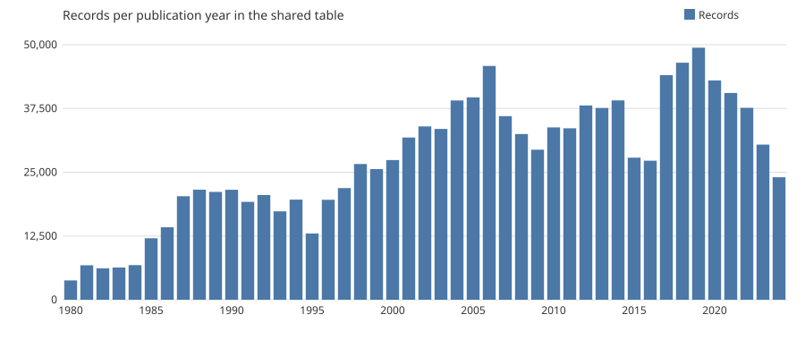
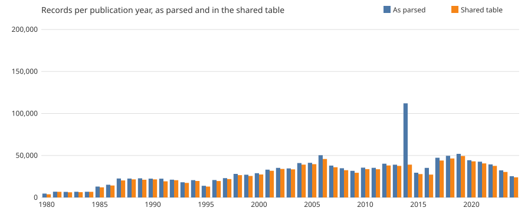

<!-- Prose template. `econ_corpus.datasheet` fills the double-brace names with numbers from the
data and writes docs/datasheet_raw.md. Edit the prose here, never the generated file. -->

# A raw table of U.S. newspaper opinion articles from ProQuest US Newsstream, {{year_min}}–{{year_max}}

Data descriptor, version 1.1 (2026-11-08). Companion to the cleaned dataset derived from this table.

## Abstract

The table holds {{n_articles}} records exported from ProQuest US Newsstream for ten U.S.
newspapers with the highest circulation, published {{year_min}}–{{year_max}}, with no ProQuest id
repeated. Each record keeps every metadata field of the export, the article text, parsed
dates, years and identifiers with explicit quality flags, its file of origin, and a hash and
word count of the text. Apart from repeated records and file footers, nothing was removed or
corrected, so the table documents the source as delivered, including news items and
publications outside the query. A companion table assigns every record one exclusion reason. This descriptor
reports how the data were collected and parsed, what they contain, and where they depart from
the intended design.

## 1. Background and summary

The table is the first stage of a corpus built to study how economists communicate with the
public through newspaper opinion pieces. It is a faithful reorganisation of the ProQuest exports,
kept raw so that other researchers can derive their own samples from it.

| | |
|---|---|
| Records | {{n_articles}}, no ProQuest id repeated |
| Removed from the parsed table | {{n_repeats_removed}} repeated ProQuest ids, {{n_text_repeats_removed}} repeats of the same text under another id and {{n_footer_rows}} file footers (section 2.4) |
| Export files | {{n_files}} |
| Publication years | {{year_min}}–{{year_max}} |
| Newspapers queried | {{n_queried_newspapers}} |
| Distinct ProQuest ids | {{n_unique_ids}} |
| Records with a named author | {{n_with_author}} ({{with_author_pct}}) |

## 2. Methods

### 2.1 Collection

- **Source:** ProQuest US Newsstream, through the Universidad de los Andes library proxy.
- **Period:** exports dated {{download_first}} to {{download_last}}.
- **Newspapers:** {{n_queried_newspapers}}, selected for having the highest circulation in the
  U.S. [1]. Online editions are included on purpose, since much current opinion is published online.
  New York Post is not provided by the subscription.
- **Query:** exact publication name AND `noft(opinion OR op-ed OR editorial)`, a full-text
  search for those words.
- **Filters:** document type Commentary, Editorial or News; English; date range resumed from the
  last download.
- **How:** 100 results per page, select all, export every 5 pages (500 records) to a `.txt`
  file. CAPTCHAs solved by hand.

### 2.2 Parsing

- Each export file is split at lines of exactly 60 underscores. The last separator is followed
  by a footer (contact and copyright lines), which is not a record.
- A record is a header, the body (after `Texto completo:`) and a block of `Label: value`
  metadata lines. The block is read backwards from its last line, one blank-separated block at a
  time, for as long as the block starts with a known label. This is needed because the optional
  `Materia` line makes the block start vary, and body lines can look like labels.
- Stray spaces that ProQuest inserts inside metadata values (`En glish`, `Aug 29, 202 2`) are
  tolerated when parsing. Values are stored as exported; space-free, case-folded copies are
  stored in the `*_key` columns. The body is never altered.
- Dates, years and identifiers are parsed with an explicit status (`ok`, `missing`,
  `unparseable`, and `year_only` for dates). No value is silently dropped.
- Every metadata label of the export gets its own column, named in English (section 3.1);
  fields that are empty in a record stay empty. The header above the text (document link,
  abstract, links) is kept too.
- Provenance is kept in `source_file` and `record_index`. The article text is stored as
  exported, together with its SHA-256 hash, word count and character count.

### 2.3 Quality control

- Per file, the records found are compared with the separator lines counted independently: all
  {{n_files}} files contain one footer and as many records as separators.
- The detection of the `Materia` line was cross-checked against a plain text search on one in
  ten files, with no disagreement (details in `docs/decisions.md`). The cross-check found and
  fixed a parsing gap that had hidden `Materia` in 3.9% of records.
- Tests use synthetic records only, and every rule is logged with its evidence in
  `docs/decisions.md`.

### 2.4 Changes applied to the export

| Change | Rows or fields affected | Reason |
|---|---|---|
| Each file split into records, one row per record | all records | A file holds hundreds of records |
| One column per metadata label, with English names, and the header fields kept | all records | Every field that exists is kept |
| Dates, years and ids parsed, with a status column; space-free `*_key` copies of categories | columns added; exported values unchanged | Comparing categories despite stray spaces |
| Hash, word count and character count of the text | columns added | Integrity checks |
| File footers removed | {{n_footer_rows}} rows | Not records |
| Repeated ProQuest ids removed; the copy with the longest body is kept, the earliest download on ties | {{n_repeats_removed}} rows | Overlapping downloads (section 5.2) |
| Repeated text removed: same body, title, date and queried newspaper under another id; the earliest download is kept | {{n_text_repeats_removed}} rows | The same article downloaded under two ids (section 5.2) |
| Nothing else removed or edited | news items, publications outside the query | Left for the cleaned dataset (section 3.2) |

## 3. Data records

### 3.1 Raw table

One row per record, as `econ_corpus_raw.csv` (UTF-8, comma-separated). It is written from
`data/interim/records.parquet`, which also holds the file footers and the repeated ids. The
text is ProQuest-licensed and the license
allows sharing it for internal use only, so the table is distributed among the project's
researchers and is not published. Spreadsheet programs truncate cells above 32,767 characters;
read the CSV with a data-analysis library instead.

| Column | Type | Content |
|---|---|---|
| `source_file` | string | Export file the record comes from |
| `record_index` | integer | Position in the file, from 0; the footer is last |
| `is_footer` | boolean | Row is a file footer; false in every row of the shared table |
| `title`, `author`, `publication`, `section` | string | Metadata as exported; multi-line values joined |
| `language`, `source_type`, `doc_type` | string | Metadata as exported |
| `year_raw`, `date_raw`, `id_raw` | string | Publication year, publication date and ProQuest id as exported |
| `subject`, `location`, `people`, `organization`, `business_index_term`, `keyword`, `classification` | string | Indexing fields (labels `Materia`, `Lugar`, `Personas`, `Empresa/organización`, `Término de indexación de negocios`, `Identificador / palabra clave`, `Clasificación`) |
| `origin_place_date`, `pages`, `page_count`, `first_page`, `issue`, `volume`, `issue_year`, `column_name` | string | Print location fields (`Lugar y fecha de origen`, `Páginas`, `Número de páginas`, `Primera página`, `Número`, `Tomo`, `Año`, `columna`) |
| `issn`, `eissn`, `coden`, `publisher`, `publication_place`, `publication_country`, `publication_subject`, `publication_history` | string | Publication fields (`ISSN`, `e-ISSN`, `CODEN`, `Editorial`, `Lugar de publicación`, `País de publicación`, `Materia de publicación`, `Historial de publicaciones`); `publication_history` is empty in every record of this export |
| `document_url`, `url`, `header_url`, `links` | string | Links: `URL del documento`, `URL`, the document link above the text, and `Enlaces` |
| `abstract` | string | `Resumen`; usually "Ninguno disponible." |
| `company`, `corporate_author`, `product_name`, `ethnicity`, `clip_duration` | string | Other fields as exported (`Empresa`, `Autor corporativo/institucional`, `Nombre del producto`, `Etnicidad`, `Duración del clip`) |
| `copyright`, `last_updated`, `database`, `fulltext_availability`, `accession_number`, `milestone_date`, `document_features`, `source_details` | string | Record-keeping fields (`Copyright`, `Última actualización`, `Base de datos`, `Disponibilidad de texto completo`, `Número de acceso`, `Fecha del hito`, `Características del documento`, `Detalles de fuente`) |
| `pub_year`, `date_year`, `doc_id` | integer | Parsed year, year of the parsed date, and ProQuest id |
| `pub_date` | date | Parsed publication date; empty if only a year is given |
| `year_status`, `date_status`, `id_status` | string | `ok`, `missing`, `unparseable`; dates also `year_only` |
| `publication_key`, `language_key`, `source_type_key`, `doc_type_key` | string | Space-free, case-folded copies for comparing categories |
| `has_materia` | boolean | Record has a `Materia` (subject) line |
| `n_meta_fields` | integer | Metadata lines recognised in the record |
| `has_body` | boolean | Record has body text |
| `body_words`, `body_chars` | integer | Word and character counts of the body |
| `body_sha256` | string | SHA-256 hash of the body text |
| `text` | string | Article text as exported (`Texto completo`); empty if the record has none |

### 3.2 Companion files

- `data/interim/exclusions.parquet`: `source_file`, `record_index` and one exclusion `reason`
  per row of the parsed table, footers and repeats included (section 6).
- `reports/tables/raw_by_year.csv` and `reports/tables/raw_by_download_date.csv`: records and
  distinct ids per year, and counts and publication-year range per download date, all as
  parsed, before repeated ids were removed.
- `reports/figures/records_by_year.svg` and `reports/figures/repeats_by_year.svg`: Figures 1 and 2.

## 4. Contents

### 4.1 Newspapers

*With author*: share of records with a named author.

{{newspapers}}

### 4.2 Online editions and the blog label

{{online_editions}}

### 4.3 Blog-labelled records by document type

{{blog_profile}}

### 4.4 Years

*Figure 1.* Records per publication year in the shared table.

{{decades}}

### 4.5 Document types and authorship

A record with two labels counts once under each. Editorials are mostly unsigned; commentary and
op-eds mostly signed.

{{doc_types}}

### 4.6 Sections

Top labels, grouped ignoring case. Each newspaper names its sections differently.

{{sections}}

### 4.7 Language

{{languages}}

### 4.8 Missing values

{{missing}}

### 4.9 Publications outside the query

Most common first. These are removed in the cleaned dataset (reason `not_queried_newspaper`).

{{other_publications}}

## 5. Technical validation

### 5.1 Do the filters hold?

| Filter | Result | Section |
|---|---|---|
| Newspapers | {{n_other_publications}} publications outside the list also appear. Queried newspapers with no records: {{missing_newspapers}} | 4.1, 4.9 |
| Source type | Not newspapers only, by design: {{n_blog}} records ({{blog_pct}}) are online editions that ProQuest labels `Blog, podcast o sitio web` | 4.1–4.3 |
| Document type | {{n_doc_type_labels}} distinct labels; {{n_outside_doc_types}} records ({{outside_doc_types_pct}}) carry none of Commentary, Editorial or News | 4.5 |
| English | {{english_only_pct}} English only; the rest bilingual or unlabelled | 4.7 |
| Dates | {{year_min}}–{{year_max}} | 4.4 |

The blog label:

- {{blog_online_pct}} of blog-labelled records are `(Online)` editions, mostly {{blog_newspapers}}.
- It belongs to the publication edition, not the article or date: per newspaper, all online
  records carry it or none do, in every year (section 4.2, last column).
- {{blog_opinion_section_pct}} sit in an opinion or editorial section (section 4.3). The content
  is news opinion, not casual blog posts.

### 5.2 Repeats

Of {{n_parsed}} parsed records, {{n_duplicate_rows}} ({{dup_pct}}) repeat a ProQuest id;
{{n_ids_parsed}} ids are distinct. {{n_ids_in_several_files}} ids appear in more than one file and
{{n_repeats_inside_a_file}} repeat inside a file, which points to overlapping downloads.
{{dup_peak_year}} stands out in Figure 2: {{dup_peak_rows}} records but only
{{dup_peak_unique}} distinct ids, because its articles were downloaded repeatedly
({{dup_peak_multi_file_pct}} of its ids appear in 3 or more files). The peak is duplication,
not more articles.

*Figure 2.* Records per publication year as parsed and in the shared table. The gap is the repeats
removed.

Apart from stray spaces, the copies of an id agree on date, newspaper, author, section and
document type. In {{n_ids_with_empty_copy}} ids one copy has no body next to a copy with text,
so the copy kept is the one with the longest body, and the earliest download if they tie. The
others are removed from the shared table.

A second kind of repeat has another id but the same body, title, date and queried newspaper
(editions of one newspaper count as one): {{n_text_repeats_removed}} records. The earliest download
is kept and the others are removed. Publications outside the query are judged only as not queried,
so repeats among them stay.

### 5.3 News and opinion

Document type is not a reliable marker of opinion. {{news_label_opinion_section_pct}} of
records have a non-opinion label but sit in an opinion section, and {{no_opinion_signal_n}}
({{no_opinion_signal_pct}}) have neither an opinion label nor an opinion section. All are kept in
the raw table.

## 6. Usage notes and limitations

- **Exclusion reasons:** the companion table gives every parsed row one reason: file footer,
  repeated id, publication not queried, repeated text (same body, title, date and newspaper),
  missing metadata, not opinion, unclear opinion, or kept. Only file footer, repeated id and
  repeated text leave the shared table; the others are flags for the cleaned dataset. Records flagged `unclear_opinion` (no section, generic type, no opinion title)
  are not dropped and are left to the user to judge. Counts:
  `reports/tables/exclusion_counts.csv`.
- **Subtler duplicates** (reprints, edited versions under another title) are not detected.
- **Authors:** {{n_with_author}} records ({{with_author_pct}}) name an author. Unsigned pieces,
  mostly editorials, cannot be linked to a person.
- **No body text:** {{n_no_body}} records, all in {{n_no_body_files}} files.
- **Metadata as exported:** values keep ProQuest's stray spaces; use the `*_key` columns to
  compare categories. Fields that are sparse (for example `url`, `company`,
  `publication_history`) are kept in case a later stage needs them.
- **License:** the table contains ProQuest text and is for internal use among the project's
  researchers only.
- **Query matches text, not genre:** the keyword search returns any article mentioning
  "opinion" or "editorial", and News is a queried document type.

## 7. Code availability

The pipeline is in the private repository `econ_corpus` [2]: `parse` (exports to table),
`export` (table to CSV), `reasons` and `exclusions`, `tables`, `figures` and `datasheet` (this
document). Every rule and its evidence are in `docs/decisions.md`. `make datasheet`
regenerates this document from the table. The repository holds code and documentation only;
the data are not in it.

## 8. References

[1] Statista, "Largest daily newspapers in the United States in the six months to September
2023, by average print circulation (in thousands)," Statista, Feb. 19, 2024. Accessed: Nov. 3,
2026. [Online]. Available:
https://www.statista.com/statistics/272790/circulation-of-the-biggest-daily-newspapers-in-the-us/

[2] J. C. Reyes, "econ_corpus: build and audit a corpus of U.S. newspaper opinion articles,"
GitHub repository, 2026. Accessed: Nov. 3, 2026. [Online]. Available:
https://github.com/JuanReyes01/econ_corpus
